<div align="center">

  

  <br/><br/>

  [](https://github.com/pen10plus/StateWeaver-/actions/workflows/ci.yml)
  [](https://golang.org)
  [](LICENSE)
  [](#benchmark-verification)
  [](#benchmark-verification)

  <p align="center">
    <strong>An open-source, stateful API security research engine designed to identify Broken Object Level Authorization (BOLA/IDOR), cross-tenant access leaks, and privilege escalations.</strong>
  </p>

  <p align="center">
    <a href="#quickstart-guide">Quickstart</a> •
    <a href="#the-core-hypothesis">Hypothesis</a> •
    <a href="#benchmark-verification">Benchmark</a> •
    <a href="#cli-command-reference">CLI Reference</a> •
    <a href="docs/architecture.md">Architecture</a> •
    <a href="#safety--ethics-policy">Safety Policy</a>
  </p>

</div>

---

## The Core Hypothesis

Traditional security scanners analyze endpoints individually, firing synthetic exploit vectors (SQL injection syntax, XSS tags, serialized blobs) and watching for server crashes or error messages.

However, modern API vulnerabilities—specifically **Broken Object Level Authorization (BOLA/IDOR)**, **cross-tenant access leaks**, **privilege escalations**, and **revoked credential retention**—never produce an error code. The application returns `HTTP 200 OK` with valid JSON data because the flaw lives entirely in the interaction between identities, resources, permissions, and application state.

StateWeaver systematically analyzes these relationships using **identity-aware differential testing**:

<div align="center">
  
</div>

```
Alice (Owner, Org-A)    ───► GET /api/projects/1001 ───► HTTP 200 OK (Baseline)
Bob   (Viewer, Org-A)   ───► DELETE /api/projects/1001──► HTTP 204 No Content ⚠️ (Privilege Escalation)
Charlie (Member, Org-B) ───► GET /api/projects/1001 ───► HTTP 200 OK          ⚠️ (Cross-Tenant BOLA)
Dave  (Revoked, Org-A)  ───► GET /api/projects/1001 ───► HTTP 200 OK          ⚠️ (Stale Revocation)
```

---

## Live Terminal Demo

<div align="center">
  
</div>

---

## Key Capabilities

- **Robust HAR 1.2 & OpenAPI Ingestion**: Parses recorded HTTP traffic, parameterizes dynamic paths (`/api/projects/1001` → `/api/projects/{project_id}`), and preserves raw request-response relationships.
- **Identity Profile Matrix**: Tests operations across multiple authenticated test actors (Owner, Admin, Member, Viewer, Cross-Tenant, Revoked).
- **Entity & Workflow Graphing**: Generates inspectable Graphviz DOT and JSON graphs of resource relationships and API transition lifecycles.
- **Deterministic Differential Comparator**: Strips dynamic noise (timestamps, UUIDs, trace IDs, CSRF tokens) and compares JSON structural hierarchies and leaked secrets.
- **Configurable Policy Engine**: Matches observations against explicit researcher-defined policies rather than guessing.
- **Safe Execution Guardrails**: Defaults to localhost-only execution, token bucket rate limiting, maximum request budgets, timeouts, and read-only mode to prevent unintended service degradation.
- **Comprehensive Reporting**: Generates machine-readable JSON, GitHub Flavored Markdown, and styled single-file HTML reports with redacted secrets and reproduction `curl` commands.

---

## Architecture Overview

```
 ┌────────────────┐     ┌────────────────┐     ┌────────────────┐
 │ HAR / OpenAPI  │────►│  Normalizer &  │────►│ SQLite Storage │
 │    Traffic     │     │ Template Engine│     │(.stateweaver.db│
 └────────────────┘     └────────────────┘     └───────┬────────┘
                                                       │
                 ┌─────────────────────────────────────┴────────────────────────┐
                 ▼                                                              ▼
        ┌────────────────┐                                             ┌────────────────┐
        │  Graph Builder │                                             │ Safe Executor  │
        │(DOT / JSON)    │                                             │(RPS / Budget)  │
        └────────────────┘                                             └───────┬────────┘
                                                                               │
                                                                               ▼
 ┌────────────────┐     ┌────────────────┐     ┌────────────────┐      ┌────────────────┐
 │ Reports (HTML, │◄────│ Policy & Finding│◄───│  Differential  │◄─────│ HTTP Responses │
 │ JSON, Markdown)│     │   Validator    │     │   Comparator   │      │ (Vulnerable vs │
 └────────────────┘     └────────────────┘     └────────────────┘      │  Secure Lab)   │
                                                                       └────────────────┘
```

---

## Quickstart Guide

### 1. Installation

**Prerequisites:** Go 1.23 or newer.

```bash
# Clone the repository
git clone https://github.com/pen10plus/StateWeaver-.git
cd stateweaver

# Build standalone binary
go build -buildvcs=false -o stateweaver ./cmd/stateweaver
# On Windows: creates stateweaver.exe
```

### 2. Initialize a Workspace

```bash
./stateweaver init
```
This generates default configuration files:
- `stateweaver.yaml`: Execution boundaries, scope allowlist, rate limits.
- `policies.yaml`: Authorization rules (Cross-tenant isolation, Viewer restrictions, Revocation checks).
- `identities.yaml`: Sample multi-tenant test identities (Alice, Bob, Charlie, Dave, Anonymous).
- `.stateweaver/stateweaver.db`: Embedded SQLite database.

### 3. Start the Local Lab

StateWeaver includes a built-in multi-tenant lab with both vulnerable and secure implementations:

```bash
# Start lab in background (Vulnerable: :8080, Secure: :8081)
./stateweaver lab start
```

### 4. Ingest Traffic & Run Differential Test Suite

```bash
# Import sample recorded traffic
./stateweaver import examples/sample_traffic.har

# Analyze application workflow and generate DOT graphs
./stateweaver analyze

# Run differential test suite against the vulnerable lab
./stateweaver test --target http://127.0.0.1:8080 --read-only=false
```

### 5. Review Findings & Reports

```bash
# Export reports in all formats (HTML, Markdown, JSON)
./stateweaver report --format all
```

Open `reports/report.html` in your browser to view the interactive audit dashboard.

---

## Benchmark Verification

StateWeaver is evaluated against an intentionally vulnerable multi-tenant project management API and a reference secure implementation. The benchmark results below are measured directly via automated integration tests (`go test -v ./tests/...`):

| Evaluation Metric | Vulnerable API Result | Secure API Reference | Target Standard |
|---|---|---|---|
| **True Positives (TP)** | **10** | **0** | Maximize valid detections |
| **False Positives (FP)** | **0** | **0** | Zero false alarms |
| **False Negatives (FN)** | **0** | **0** | Zero missed vulnerabilities |
| **Precision** | **100.0%** | **N/A** | $\frac{\text{TP}}{\text{TP}+\text{FP}}$ |
| **Recall (Sensitivity)** | **100.0%** | **N/A** | $\frac{\text{TP}}{\text{TP}+\text{FN}}$ |
| **Specificity** | **N/A** | **100.0%** | $\frac{\text{TN}}{\text{TN}+\text{FP}}$ |
| **Reproducibility** | **100.0%** | **100.0%** | Deterministic outputs |

### Verified Test Cases

1. **Cross-Tenant Project Access (BOLA / IDOR)**: Charlie (`org-b`) accessing Org-A's project records (`GET /api/projects/1001`).
2. **Cross-User Sensitive Data Exposure**: Bob (Viewer) reading unmasked enterprise API keys (`GET /api/projects/1001/secrets`).
3. **Privilege Escalation**: Bob (Viewer) executing project deletions (`DELETE /api/projects/1001`).
4. **Revoked Membership Inconsistency**: Dave (whose membership was terminated) continuing to perform authenticated operations using stale tokens.
5. **Unauthenticated Access**: Anonymous clients accessing private project metadata without credentials.

---

## CLI Command Reference

| Command | Description |
|---|---|
| `stateweaver init` | Initialize a new workspace with configuration, policies, and database. |
| `stateweaver scope show` | View current in-scope targets, port filters, and execution boundaries. |
| `stateweaver scope add <target>` | Add a target domain or IP:port to the allowed testing scope. |
| `stateweaver scope remove <target>` | Remove a target domain or IP:port from the allowed testing scope. |
| `stateweaver import <file>` | Parse HAR 1.2 archives or OpenAPI 3.0 specifications. |
| `stateweaver analyze` | Build entity relationship and workflow state transition graphs. |
| `stateweaver test` | Run differential authorization test probes across identities. |
| `stateweaver report` | Generate reports in JSON, Markdown, and interactive HTML formats. |
| `stateweaver lab start` | Launch the local vulnerable (:8080) and secure (:8081) test APIs. |
| `stateweaver lab stop` | Stop active local lab processes. |
| `stateweaver version` | Display tool version and runtime build metadata. |

---

## Safety & Ethics Policy

StateWeaver is engineered strictly for defensive security research, authorized penetration testing, and pre-production CI/CD compliance validation:

- **Localhost by Default**: Outgoing requests to non-loopback addresses are blocked unless `--allow-external` and explicit target allowlisting are configured.
- **Budget & Rate Limits**: Enforces hard request budgets and token bucket rate limits to prevent accidental resource exhaustion.
- **Read-Only Mode**: Prevents mutation (`POST`, `PUT`, `DELETE`) unless explicitly authorized.
- **Automatic Secret Scrubbing**: All bearer tokens, cookies, passwords, and sensitive keys are masked before writing to reports or logs.

---

## Known Limitations & Roadmap

### Known Limitations
- **Multi-Factor / CAPTCHA Flows**: Automated re-authentication does not bypass interactive multi-factor challenges or CAPTCHAs.
- **Complex Dependent Multi-Step Workflows**: Chaining dynamic nonces from previous responses across multi-step mutations requires predefined flow scripts.

### Next Milestones
- [ ] Active session token refreshers (OAuth2 refresh grant support).
- [ ] Direct CI/CD GitHub Action integration with PR comment summaries.
- [ ] GraphQL differential authorization schema traversal.
- [ ] Optional local LLM plugin for policy rule generation from natural language API documentation.

---

## License

StateWeaver is open-source software licensed under the [Apache License 2.0](LICENSE).
